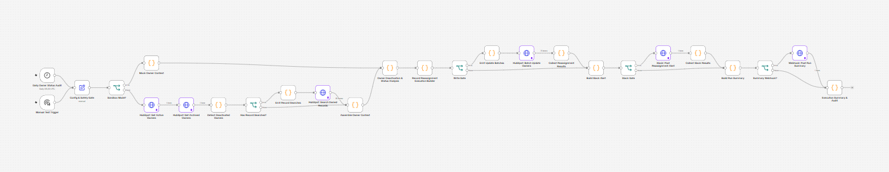

<div align="center">

# n8n-hubspot-owner-deactivation-lead-reassignment-sentinel

**RevOps safety net workflow that detects when a HubSpot sales owner is deactivated, automatically reallocating their open deals, contacts, and unassigned tasks to active coverage reps.**

A dhRobin Systems Revenue Infrastructure blueprint

    

</div>

---

## Table of Contents

1. [Overview](#1-overview)
2. [Architecture and Data Flow](#2-architecture-and-data-flow)
3. [Repository Contents](#3-repository-contents)
4. [Prerequisites](#4-prerequisites)
5. [5-Minute Sandbox Quick Start](#5-5-minute-sandbox-quick-start)
6. [Step-by-Step Import and Configuration Guide](#6-step-by-step-import-and-configuration-guide)
7. [Environment Variables](#7-environment-variables)
8. [Node-by-Node Configuration Guide](#8-node-by-node-configuration-guide)
9. [Reassignment Routing Logic and Fallback Mechanisms](#9-reassignment-routing-logic-and-fallback-mechanisms)
10. [Safeguards](#10-safeguards)
11. [RevOps Best Practices](#11-revops-best-practices)
12. [Safety Matrix](#12-safety-matrix)
13. [Data Protection and Compliance Checklist](#13-data-protection-and-compliance-checklist)
14. [Operations, Rollback and Troubleshooting](#14-operations-rollback-and-troubleshooting)
15. [Disclaimer and License](#15-disclaimer-and-license)

---

## 1. Overview

When a rep leaves, IT deactivates their HubSpot user the same afternoon. Their open deals, their leads and their follow-up tasks stay assigned to an owner who will never log in again. Nobody gets the task reminders, round-robin rotations skip them, and forecasts keep a pipeline nobody is working. The usual fix is a manual clean-up weeks later, after a customer has gone quiet.

I built this workflow as a daily safety net. HubSpot lists deactivated users as **archived owners**. The workflow reads the active and archived owner lists and looks for deactivated owners who still own records:

- open deals (`hs_is_closed = false`);
- open contacts (lifecycle stage outside `customer`, `evangelist` by default);
- tasks that aren't completed.

After a grace period, each owner's records go to an active coverage rep. The rep comes from a direct mapping, the owner's team pool, a backup round-robin pool or a fallback owner, in that order. Every target is checked against the active owner list first. The changes are batch updates of `hubspot_owner_id`. RevOps gets a Slack summary with links to the reassigned records. The run summary lists every from → to change and a rollback payload.

**Outputs per deactivated owner**

| Field | Values |
|---|---|
| `state` | `reassign`, `reassign_partial`, `pending_grace`, `held_no_coverage`, `held_mass_deactivation`, `search_failed`, `no_open_records` |
| `objects.<deals\|contacts\|tasks>` | open count, remaining beyond this run, route (`direct_map`, `team_pool`, `backup_pool`, `fallback_owner`, `none`) and pool |
| reassignments | object, record ID, from owner, to owner, route, result (`planned`, `updated`, `failed`) |

**Design principles**

| Principle | Implementation |
|---|---|
| Safe by default | With no environment variables set, it makes **zero HubSpot calls, zero writes and zero Slack calls**. Writes need `SANDBOX_MODE=false`, `DRY_RUN=false` and `REASSIGNMENT_ENABLED=true`. |
| Never assign to an inactive owner | Every mapped, team, backup and fallback target must be in the active owner list. Invalid targets are skipped and reported. |
| Grace before action | Owners deactivated less than `GRACE_PERIOD_HOURS` ago (default 12) are reported, not reassigned, so an accidental deactivation can be reversed. |
| Hold mass events | If more owners than `MASS_DEACTIVATION_THRESHOLD` were deactivated within `MASS_DEACTIVATION_WINDOW_HOURS` and need reassignment, everything is held for review. This covers an SSO or SCIM mishap or a reorganisation. |
| Bounded runs | At most `MAX_REASSIGNMENTS_PER_RUN` records per run. Searches page through owners' records over consecutive runs, because reassigned records drop out of the next search. |
| Reversible | Every change is logged with its previous owner; optional `PREVIOUS_OWNER_PROPERTY` stamps it on the record; the run summary carries rollback payloads. |
| Secrets out of data | The HubSpot token and webhook URLs appear only as `{{ $env.* }}` in HTTP header and URL fields. No Code node reads a secret. |

---

## 2. Architecture and Data Flow

```mermaid
flowchart LR
    SCH[Daily Owner Status Audit<br/>06:20 UTC] --> CFG
    MAN[Manual Test Trigger] --> CFG[Config & Safety Gate<br/>mapping · pools · flags]
    CFG --> SB{Sandbox Mode?}
    SB -- yes --> MOCK[Mock Owner Context<br/>sample-payloads/hubspot-owners-and-records.json]
    SB -- no --> AO[HubSpot: Get Active Owners] --> RO[HubSpot: Get Archived Owners] --> DET[Detect Deactivated Owners]
    DET --> HS{Has Record Searches?}
    HS -- yes --> ES[Emit Record Searches<br/>owner × deals / contacts / tasks] --> SR[HubSpot: Search Owned Records] --> ASM
    HS -- no --> ASM[Assemble Owner Context]
    MOCK --> AN
    ASM --> AN[Owner Deactivation &<br/>Status Analysis<br/>filters · grace · mass guard · routing]
    AN --> BLD[Record Reassignment<br/>Execution Builder<br/>round-robin · batches ≤100 · rollback]
    BLD --> WG{Write Gate}
    WG -- yes --> EB[Emit Update Batches] --> BU[HubSpot: Batch Update Owners<br/>/crm/v3/objects/type/batch/update] --> COL[Collect Reassignment Results] --> SLB
    WG -- no --> SLB[Build Slack Alert]
    SLB --> SG{Slack Gate}
    SG -- yes --> SP[Slack: Post Reassignment Alert] --> CS[Collect Slack Results] --> SUM
    SG -- no --> SUM[Build Run Summary]
    SUM --> SW{Summary Webhook?}
    SW -- yes --> WH[Webhook: Post Run Summary] --> AUD
    SW -- no --> AUD[Execution Summary & Audit]
```





### Stage contracts

| Stage | Output shape |
|---|---|
| Detect Deactivated Owners | `{ owners: { active[], archived[] }, warnings[], readErrors[], searches: [{ ownerId, objectType, body }] }` |
| Mock Owner Context / Assemble Owner Context | `{ source, portalId, owners: { active[], archived[] }, records: { <ownerId>: { deals \| contacts \| tasks: { results[], total, error } } }, warnings[], readErrors[] }` |
| Owner Deactivation & Status Analysis | `{ status: clear \| reassignment_due \| action_required \| error, owners: [{ ownerId, name, source, deactivatedAt, hoursSinceDeactivation, graceEndsAt, state, objects, notes[] }], excludedOwners[], activeOwners{}, counts, massGuard }` |
| Record Reassignment Execution Builder | Same, plus `assignments[{ objectType, recordId, fromOwnerId, toOwnerId, level }]`, `deferred[]`, `batches[{ objectType, batch, recordIds, body: { inputs } }]`, `rollback[]`, `writeAllowed` |
| Collect Reassignment Results | `{ updated, failed, failures[], assignments[] (with result) }` |
| Execution Summary & Audit | Outcome, safety flags, per-owner state and routes, every reassignment with result, deferred records, failures, rollback payloads, delivery |

---

## 3. Repository Contents

```
n8n-hubspot-owner-deactivation-lead-reassignment-sentinel/
├── README.md                                Technical documentation (this file)
├── workflow.json                            Importable n8n workflow with sticky notes and pinned synthetic payloads
├── DISCLAIMER.md                            Liability limitation and usage terms
├── LICENSE                                  MIT License
└── sample-payloads/
    └── hubspot-owners-and-records.json      Synthetic owners (active + archived), coverage mapping, open/closed deals, contacts, tasks
```

All owners, names, emails (`@example.com`), owner, user and team IDs, companies and records are fictitious. Deactivation times are relative offsets resolved at run time.

---

## 4. Prerequisites

| Requirement | Detail |
|---|---|
| n8n | Self-hosted **1.60 or later** (Schedule Trigger 1.2, Set 3.4, IF 2, Code 2, HTTP Request 4.2 with batching, `$('Node').isExecuted`, `v1` execution order). |
| Env access | `N8N_BLOCK_ENV_ACCESS_IN_NODE=false`, so `{{ $env.* }}` expressions resolve. |
| HubSpot private app scopes | **`crm.objects.owners.read`**: owner lists, including archived (deactivated) owners. **`crm.objects.deals.write`**: search and reassign deals. **`crm.objects.contacts.write`**: search and reassign contacts. **`crm.objects.tasks.write`**: reassign tasks (use the write scope HubSpot lists for the Tasks API in your portal, plus its read scope if your portal lists one separately for task search). Write scopes include viewing; add the matching `.read` scopes if your app shows them separately. Grant only the objects in `REASSIGN_OBJECTS`. |
| Optional property | `previous_owner_id` (single-line text) on deals and contacts, to stamp the previous owner on each reassigned record (`PREVIOUS_OWNER_PROPERTY`). |
| Slack | An incoming webhook for the RevOps channel. |

> **n8n Cloud:** you can't define your own environment variables there. Replace `$env.X` with `$vars.X` (on plans with Variables) or n8n credentials. The workflow logic is unchanged.

---

## 5. 5-Minute Sandbox Quick Start

1. **Run n8n locally:**
   ```bash
   docker run -it --rm -p 5678:5678 \
     -e N8N_BLOCK_ENV_ACCESS_IN_NODE=false \
     -e GENERIC_TIMEZONE=UTC \
     -v n8n_data:/home/node/.n8n \
     docker.n8n.io/n8nio/n8n
   ```
2. **Import** `workflow.json` (*Workflows → Import from File*).
3. Click **Test workflow** on *Manual Test Trigger*.
4. Open **Owner Deactivation & Status Analysis**, **Record Reassignment Execution Builder**, **Build Slack Alert** and **Execution Summary & Audit**.

The sandbox uses the fixture's synthetic coverage mapping:

- `REASSIGNMENT_MAP`: 55001 per object, 55008 → 55010.
- `TEAM_COVERAGE`: team 7001 → [55002], team 7002 → [55003, 55009].
- `BACKUP_COVERAGE_OWNER_IDS`: 55002, 55003.
- `FALLBACK_OWNER_ID`: 55009.
- `EXCLUDED_OWNER_IDS`: 55007.

**Expected sandbox result** (nothing sent or written):

| Owner | Situation | Result |
|---|---|---|
| `55001` Dana Whitfield (archived 30 h ago) | 4 open deals (+1 closed won), 3 open contacts (+1 customer), 3 open tasks (+1 completed) | **4 deals → 55002 Marcus Vance, 3 contacts → 55003 Priya Raman, 3 tasks → 55002** (direct per-object map). Closed, customer and completed records are left alone |
| `55008` Omar Castillo (archived 2 years ago) | 2 deals, 1 contact, 1 task. Mapped to 55010, which is itself deactivated | Mapping skipped with a warning → **SMB team pool, round-robin**: deals → 55003, 55009; contact → 55003; task → 55009 |
| `55004` Jordan Ellis (`active: false`) | 1 deal, 1 task, no mapping | **Enterprise team pool** → 55002 |
| `55005` Leo Hartmann (archived 3 h ago) | 2 deals, 1 contact | ⏳ **Grace period**: reported, reassigned after 12 h |
| `55006` Nina Brooks, `55010` Grace Okafor | No open records | Nothing to do |
| `55007` Integration User | Excluded service owner | Skipped |

Outcome `reassignment_planned_sandbox`: **16 records** (7 deals, 4 contacts, 5 tasks) in 3 batch payloads.

---

## 6. Step-by-Step Import and Configuration Guide

Each step changes one thing and has an exit check.

| Step | Configuration | Exit check |
|---|---|---|
| **1. Import and sandbox** | Defaults | The table in [§5](#5-5-minute-sandbox-quick-start) is reproduced. |
| **2. Pinned live path** | `SANDBOX_MODE=false`, `HUBSPOT_ACCESS_TOKEN=synthetic`, the fixture mapping as env vars (`REASSIGNMENT_MAP`, `TEAM_COVERAGE`, `FALLBACK_OWNER_ID=55009`, `EXCLUDED_OWNER_IDS=55007`), `HUBSPOT_PORTAL_ID=99000001`. Run **Test workflow** | All nodes run on pinned synthetic responses: 18 searches, 16 planned reassignments, outcome `reassignment_planned_dry_run`. Nothing leaves n8n. |
| **3. Design coverage** | List your teams and owner IDs (*Settings → Users & Teams*, or `GET /crm/v3/owners`). Set `TEAM_COVERAGE`, `BACKUP_COVERAGE_OWNER_IDS`, `FALLBACK_OWNER_ID` (a sales manager or a queue owner) and `EXCLUDED_OWNER_IDS` (integration and service users) | The routes in the analysis output match your coverage plan. |
| **4. Live reads, dry run** | Create the private app ([§4](#4-prerequisites)). Unpin the owner and search nodes (*right-click → Unpin*). Real token, `DRY_RUN=true` | The analysis lists your real deactivated owners, their open records and planned targets. Review it with sales leadership. |
| **5. Slack, still no writes** | Unpin *Slack: Post Reassignment Alert*. `DRY_RUN=false`, `SEND_SLACK_ALERTS=true`, `REASSIGNMENT_ENABLED` unset | Slack shows "would be reassigned", outcome `reassignment_planned_disabled`. |
| **6. First writes, small** | Unpin *HubSpot: Batch Update Owners*. `REASSIGNMENT_ENABLED=true`, `MAX_REASSIGNMENTS_PER_RUN=25`, optionally `PREVIOUS_OWNER_PROPERTY=previous_owner_id` | 25 records move; the new owners see them; the run summary has the rollback payload. |
| **7. Schedule** | Raise `MAX_REASSIGNMENTS_PER_RUN` to your normal volume and activate the workflow | Backlog drains over a few runs; later runs alert only on changes. |

### Mapping formats

```jsonc
// REASSIGNMENT_MAP: deactivated owner ID → target
{
  "55001": { "deals": "55002", "contacts": "55003", "tasks": "55002" },  // per object (optional "default")
  "55011": "55002",                                                      // one rep for everything
  "55012": ["55002", "55003"]                                            // round-robin pool
}

// TEAM_COVERAGE: HubSpot team ID → coverage pool
{ "7001": ["55002"], "7002": ["55003", "55009"] }
```

All IDs are **owner IDs** (`id` from the Owners API), not user IDs. The values above are placeholders.

---

## 7. Environment Variables

All variables are optional. Unset values resolve to the safest behaviour. In sandbox mode, the coverage variables default to the fixture's synthetic mapping. Outside sandbox they default to empty.

### 7.1 Safety gate

| Variable | Default | Effect |
|---|---|---|
| `SANDBOX_MODE` | `true` | Synthetic owners and records. No HubSpot, Slack or webhook calls. |
| `DRY_RUN` | `true` | Live reads and full planning. No writes, no Slack, no webhook. |
| `REASSIGNMENT_ENABLED` | `false` | Explicit opt-in for owner updates in HubSpot. |
| `SEND_SLACK_ALERTS` | `false` | Explicit opt-in for Slack (also needs `SLACK_ALERT_WEBHOOK_URL`). |

### 7.2 Coverage routing

| Variable | Default | Effect |
|---|---|---|
| `REASSIGNMENT_MAP` | — | JSON: owner → rep, pool or per-object targets ([§6](#mapping-formats)). Invalid JSON stops the run with a config alert. |
| `TEAM_COVERAGE` | — | JSON: team ID → pool. The owner's primary team is tried first. |
| `BACKUP_COVERAGE_OWNER_IDS` | — | Comma-separated round-robin pool used when no map or team pool applies. |
| `FALLBACK_OWNER_ID` | — | Last resort (sales manager or queue owner). |
| `EXCLUDED_OWNER_IDS` | — | Owners never treated as deactivated (integration, import or service users). |
| `REASSIGN_OBJECTS` | `deals,contacts,tasks` | Objects to reassign. |

### 7.3 Record filters and limits

| Variable | Default | Effect |
|---|---|---|
| `CONTACT_EXCLUDE_LIFECYCLE_STAGES` | `customer,evangelist` | Contacts in these stages keep their owner (often CS-owned). Contacts without a lifecycle stage are included. |
| `DEAL_EXCLUDE_STAGES` | — | Additional deal stage IDs to leave alone (closed deals are always excluded). |
| `GRACE_PERIOD_HOURS` | `12` | Wait after deactivation before reassigning. `0` disables. |
| `DEACTIVATION_LOOKBACK_DAYS` | `0` (all) | Only consider owners deactivated within this many days. |
| `MASS_DEACTIVATION_THRESHOLD` | `3` | Hold everything when more owners than this, deactivated within the window, need reassignment. `0` disables. |
| `MASS_DEACTIVATION_WINDOW_HOURS` | `72` | Window for the mass guard. |
| `MAX_REASSIGNMENTS_PER_RUN` | `500` | Records per run; the rest wait for the next run. |
| `SEARCH_PAGE_SIZE` | `100` | Records read per owner and object per run. |

### 7.4 Write-back, alerts and links

| Variable | Default | Effect |
|---|---|---|
| `HUBSPOT_ACCESS_TOKEN` 🔒 | — | Private app token. |
| `HUBSPOT_API_BASE_URL` | `https://api.hubapi.com` | API base URL. |
| `PREVIOUS_OWNER_PROPERTY` | — | Property stamped with the previous owner ID (must exist). |
| `PREVIOUS_OWNER_PROPERTY_OBJECTS` | `deals,contacts` | Objects that have that property. |
| `SLACK_ALERT_WEBHOOK_URL` 🔒 | — | RevOps channel incoming webhook. |
| `SUPPRESS_REPEAT_ALERTS` | `true` | Don't re-post an unchanged state (pending, held, planned) in production runs. Runs that write always alert. |
| `ALERT_ON_READ_FAILURE` | `true` | Alert when the owner lists can't be read. |
| `NOTIFY_WHEN_CLEAR` | `false` | Post when no deactivated owner owns anything. |
| `SHOW_OWNER_EMAIL` | `false` | Show the deactivated owner's email in Slack. |
| `SHOW_RECORD_NAMES` | `false` | Show deal names and task subjects in links (contacts are always shown by ID). |
| `SAMPLE_LINKS_PER_OBJECT` | `3` | Record links per owner and object. |
| `HUBSPOT_PORTAL_ID` | — | Builds record and settings links. |
| `HUBSPOT_APP_HOST` | `app.hubspot.com` | e.g. `app-eu1.hubspot.com`. |
| `HUBSPOT_USERS_SETTINGS_URL_TEMPLATE` | `https://{appHost}/settings/{portalId}/users` | Users & Teams settings link. Verify it in your portal and override if needed. |
| `ALERT_WEBHOOK_URL` 🔒 | — | Optional run summary JSON. |
| `ALERT_WEBHOOK_TOKEN` 🔒 | — | Bearer token for it. |
| `NOTIFY_ON_EVERY_RUN` | `false` | Send the run summary even without an alert. |

🔒 = secret. Inject from a secret manager, never commit.

### 7.5 Sample `.env` (staging)

```bash
# n8n runtime
N8N_BLOCK_ENV_ACCESS_IN_NODE=false

# Safety gate: live reads, Slack on, writes still off
SANDBOX_MODE=false
DRY_RUN=false
REASSIGNMENT_ENABLED=false
SEND_SLACK_ALERTS=true

# Coverage routing (placeholder owner and team IDs)
REASSIGNMENT_MAP={"55001":{"deals":"55002","contacts":"55003","tasks":"55002"}}
TEAM_COVERAGE={"7001":["55002"],"7002":["55003","55009"]}
BACKUP_COVERAGE_OWNER_IDS=55002,55003
FALLBACK_OWNER_ID=55009
EXCLUDED_OWNER_IDS=55007

# Filters and limits
CONTACT_EXCLUDE_LIFECYCLE_STAGES=customer,evangelist
GRACE_PERIOD_HOURS=12
MASS_DEACTIVATION_THRESHOLD=3
MAX_REASSIGNMENTS_PER_RUN=100
PREVIOUS_OWNER_PROPERTY=previous_owner_id
HUBSPOT_PORTAL_ID=

# Secrets (inject from your secret manager; never commit)
HUBSPOT_ACCESS_TOKEN=
SLACK_ALERT_WEBHOOK_URL=
ALERT_WEBHOOK_URL=
ALERT_WEBHOOK_TOKEN=
```

---

## 8. Node-by-Node Configuration Guide

### 8.1 Triggers and Config & Safety Gate

**Daily Owner Status Audit** runs at 06:20 UTC. **Config & Safety Gate**:

- parses the mapping JSON (invalid JSON is flagged, never ignored);
- keeps only numeric owner IDs, clamps numbers and validates hosts and property names;
- records only whether each secret or URL is set.

### 8.2 Owner reads and record searches (live)

| Node | Call |
|---|---|
| HubSpot: Get Active Owners | `GET /crm/v3/owners?limit=500&archived=false` |
| HubSpot: Get Archived Owners | `GET /crm/v3/owners?limit=500&archived=true` (deactivated users: `userId` is null) |
| HubSpot: Search Owned Records | `POST /crm/v3/objects/{deals\|contacts\|tasks}/search`, one per owner × object, 4 per second |

| Object | Search filter |
|---|---|
| Deals | `hubspot_owner_id = owner` AND `hs_is_closed = false` |
| Contacts | `hubspot_owner_id = owner` AND (`lifecyclestage NOT_IN` excluded stages OR no lifecycle stage) |
| Tasks | `hubspot_owner_id = owner` AND `hs_task_status ≠ COMPLETED` |

A failed owner read stops the run with an alert: targets can't be validated without the active list. A failed search becomes an error for that owner and object only; the records are retried next run, never assumed empty.

### 8.3 Analysis and builder

**Owner Deactivation & Status Analysis** implements [§9](#9-reassignment-routing-logic-and-fallback-mechanisms) and [§10](#10-safeguards). It re-applies the open-record filters to the search results as a second check.

**Record Reassignment Execution Builder**:

- sorts each owner's records by ID;
- walks the route's pool round-robin, with the cursor persisted per pool in production;
- stops at `MAX_REASSIGNMENTS_PER_RUN`;
- builds one batch per object type and 100 records: `{ "inputs": [{ "id": "8100101", "properties": { "hubspot_owner_id": "55002", "previous_owner_id": "55001" } }] }`;
- builds the rollback payloads.

### 8.4 Batch updates

**HubSpot: Batch Update Owners** posts each batch to `/crm/v3/objects/{deals|contacts|tasks}/batch/update`, about 5 per second, with no automatic retry. **Collect Reassignment Results** marks each record as `updated` only if HubSpot returned its ID. It reads partial failures from `errors[]` and full failures from the error item.

### 8.5 Slack alert

- **Header:** e.g. `🔁 16 records reassigned from 3 deactivated owners`, with a mode tag when nothing changed.
- **Counts:** deactivated, with records, in grace period, held, nothing open, excluded.
- **One section per owner:**
  - name, owner ID, team and deactivation age;
  - per object: count → target(s) with round-robin split and route, plus failures;
  - up to 3 record links per object;
  - records left for the next run, and routing warnings (e.g. "direct map target 55010 is not an active owner").
- **Pending and held owners**, with the grace period end or the fix.
- **Error log**, then a **Users & teams settings** button and a context line.

### 8.6 Run summary and audit

**Build Run Summary** creates `event: "hubspot.owner_deactivation.run"`. It contains every owner state, every reassignment (`record_id`, `from_owner_id`, `to_owner_id`, `route`, `result`) and the rollback payloads, so HR, IT offboarding or ticketing tools can track it.

**Execution Summary & Audit** outcomes:

- `reassigned`, `reassigned_with_errors`, `reassignment_failed`;
- `reassignment_planned_sandbox`, `reassignment_planned_dry_run`, `reassignment_planned_disabled`;
- `pending_grace_period`, `held_no_coverage`, `held_mass_deactivation`;
- `owner_read_failed`, `config_invalid`;
- `no_open_records_on_deactivated_owners`.

---

## 9. Reassignment Routing Logic and Fallback Mechanisms

### 9.1 Deactivation detection

| Signal | Source |
|---|---|
| `archived: true` | Owner returned by `GET /crm/v3/owners?archived=true` (HubSpot's representation of a deactivated user) |
| `active: false` | Owner in the active list flagged inactive (supported for owner sources that expose the flag) |
| Deactivation time | The owner's `updatedAt` (proxy; HubSpot doesn't expose a separate deactivation timestamp) |

### 9.2 Coverage resolution (per owner and object)

| Order | Level | Source | Example |
|---|---|---|---|
| 1 | `direct_map` | `REASSIGNMENT_MAP[owner]`: a rep, a pool, or per-object targets (`deals` / `contacts` / `tasks` / `default`) | 55001 deals → 55002 |
| 2 | `team_pool` | `TEAM_COVERAGE[team]` for the owner's teams (primary first) | team 7002 → [55003, 55009] |
| 3 | `backup_pool` | `BACKUP_COVERAGE_OWNER_IDS` | [55002, 55003] |
| 4 | `fallback_owner` | `FALLBACK_OWNER_ID` | 55009 |
| 5 | `none` | — | Records **held**, owner alerted as `held_no_coverage` |

At every level, targets that aren't active owners, are excluded, or are the deactivated owner are removed. If none remain, the next level is tried. Each skip is reported (e.g. *direct map target 55010 is not an active owner*).

### 9.3 Distribution

A single target gets all records. A pool is distributed round-robin in record-ID order. The cursor is kept per pool across runs (production executions), so successive deactivations spread evenly. Records of one owner are handled together before the next owner.

### 9.4 States

| State | Meaning | Action |
|---|---|---|
| `reassign` | Open records and a valid route for each object | Reassign |
| `reassign_partial` | Some objects have no route | Reassign the routable objects, alert on the rest |
| `pending_grace` | Deactivated less than `GRACE_PERIOD_HOURS` ago | Report the open records and when the grace period ends |
| `held_no_coverage` | Open records, no valid target at any level | Alert with the fix |
| `held_mass_deactivation` | Mass guard tripped | Alert for review |
| `search_failed` | Searches failed, nothing known | Alert, retry next run |
| `no_open_records` | Nothing to do | Counted only |

---

## 10. Safeguards

| Risk | Safeguard |
|---|---|
| Accidental deactivation | `GRACE_PERIOD_HOURS` (default 12) before any reassignment |
| SSO or SCIM mishap or bulk offboarding | Mass guard: more than `MASS_DEACTIVATION_THRESHOLD` recently deactivated owners hold everything for review |
| Assigning to another departed rep | Every target is checked against the active owner list at every routing level |
| Wrong routing config | Invalid `REASSIGNMENT_MAP` / `TEAM_COVERAGE` JSON stops the run with `config_invalid`; no silent fallback |
| Integration or service owners | `EXCLUDED_OWNER_IDS` are never treated as deactivated or used as targets |
| Closed business moved around | Closed deals, excluded lifecycle stages and completed tasks are filtered in the search **and** again in the analysis |
| Customer accounts moved to sales | `CONTACT_EXCLUDE_LIFECYCLE_STAGES` (default `customer,evangelist`) |
| Runaway volume | `MAX_REASSIGNMENTS_PER_RUN`, `SEARCH_PAGE_SIZE`; remaining records are reported and picked up next run |
| Failed reads treated as "nothing open" | Owner read failures stop the run; search failures are reported per owner and object |
| Silent partial writes | Each record is confirmed against the batch response; failures are listed in Slack and the audit |
| No way back | Previous owner in the audit, the run summary, optional `PREVIOUS_OWNER_PROPERTY`, and rollback payloads |
| Alert fatigue | Unchanged states aren't re-posted; runs that write always alert |

---

## 11. RevOps Best Practices

- **Define coverage before anyone leaves.** Agree a `TEAM_COVERAGE` pool per team and a `FALLBACK_OWNER_ID` (sales manager or queue owner) with sales leadership, and review it every quarter.
- **Map planned departures directly.** For a known exit, add a direct `REASSIGNMENT_MAP` entry for the hand-over rep before IT deactivates the user. Deals go to the rep who has the context.
- **Treat customers separately.** Leave customers to CS ownership (`CONTACT_EXCLUDE_LIFECYCLE_STAGES`) or map them to the account manager explicitly.
- **Keep companies in mind.** This workflow reassigns deals, contacts and tasks. If company ownership drives territory, align company owners in the same review.
- **Stamp the previous owner.** `PREVIOUS_OWNER_PROPERTY=previous_owner_id` makes hand-over reporting and rollback simple.
- **Exclude integration users.** Import, sync and integration owners belong in `EXCLUDED_OWNER_IDS`.
- **Connect offboarding.** Send the run summary to your HR, IT offboarding or ticketing tool so the hand-over is part of the leaver checklist.
- **Tell the receiving reps.** HubSpot notifies new owners according to their notification settings. A Slack thread per hand-over sets context faster.

---

## 12. Safety Matrix

| `SANDBOX_MODE` | `DRY_RUN` | `REASSIGNMENT_ENABLED` | `SEND_SLACK_ALERTS` | HubSpot reads | Owner reassignment | Slack alert | Run summary webhook |
|:---:|:---:|:---:|:---:|:---:|:---:|:---:|:---:|
| `true` *(default)* | any | any | any | No (fixture) | No | No | No |
| `false` | `true` *(default)* | any | any | Yes | No | No | No |
| `false` | `false` | `false` *(default)* | `false` *(default)* | Yes | No | No | Yes, if URL set |
| `false` | `false` | `false` | `true` | Yes | No | **Yes** ("would be reassigned") | Yes, if URL set |
| `false` | `false` | `true` | `false` | Yes | **Yes** | No | Yes, if URL set |
| `false` | `false` | `true` | `true` | Yes | **Yes** | **Yes** | Yes, if URL set |

Even with every flag on, nothing is written during the grace period, while the mass guard is tripped, for owners without valid coverage, or beyond `MAX_REASSIGNMENTS_PER_RUN`.

**Pinned data:** pins apply only to manual executions. Scheduled production runs always call live endpoints according to this matrix. Batch updates don't retry automatically; unconfirmed records are reported and picked up by the next run's search.

---

## 13. Data Protection and Compliance Checklist

The workflow processes employee data (owner names, emails, team membership, deactivation timing) and CRM record identifiers.

| Data element | Read | In Slack | In run summary / audit |
|---|:---:|:---:|:---:|
| Owner ID, name, team | ✓ | ✓ | Owner ID and state |
| Owner email | ✓ | Only with `SHOW_OWNER_EMAIL=true` | ✗ |
| Deactivation time | ✓ | Age (hours or days) | ✓ |
| Deal name, task subject | ✓ | Only with `SHOW_RECORD_NAMES=true` | ✗ |
| Contact name or email | ✗ (not requested) | ✗ (ID links only) | ✗ |
| Record IDs, from and to owner | ✓ | Links | ✓ |

- [ ] **Employee privacy:** a Slack post announcing who was deactivated is a disclosure about an employee. Keep the channel private to RevOps and sales leadership, and align with HR and works council guidance.
- [ ] **Customer data:** reassigned contacts get a new account owner. Confirm your privacy notice covers internal reassignment, and that the new owner is entitled to the data (region, business unit, data residency).
- [ ] **Access control:** reassignment doesn't change HubSpot permissions. Check that receiving reps' teams and permission sets allow them to see and work the records.
- [ ] **Least privilege:** the private app has `crm.objects.owners.read` and only the write scopes for the objects in `REASSIGN_OBJECTS`.
- [ ] **Audit trail:** keep the run summaries (or the execution data) as long as your change-management policy requires.
- [ ] **Execution data** retention is set (`EXECUTIONS_DATA_PRUNE=true`, a sensible `EXECUTIONS_DATA_MAX_AGE`).
- [ ] **Secrets** are injected from a secret manager and rotated if an execution export leaves your team.
- [ ] **Version control hygiene:** before committing an edited workflow, run:

```bash
grep -nE '(pat-[a-z0-9]{2}-[a-f0-9-]{20,}|hooks\.slack\.com/services/[A-Z0-9]+/|Bearer [A-Za-z0-9._-]{20,})' workflow.json && echo "Possible secret found" || echo "Clean"
```

---

## 14. Operations, Rollback and Troubleshooting

### 14.1 Call volume per run

| Calls | Count |
|---|---|
| Owner lists | 2 |
| Searches | deactivated owners × objects (owners outside the lookback or excluded aren't searched) |
| Batch updates | ⌈records ÷ 100⌉ per object |
| Slack and webhook | 0 or 1 each |

### 14.2 Rollback

The run summary and the audit contain `rollback`: one batch-update payload per object with each record's previous owner. HubSpot may reject assigning records back to an archived owner. In that case, reassign to another active owner, or reactivate the user first and post the payload to `/crm/v3/objects/{objectType}/batch/update`.

### 14.3 Troubleshooting

| Symptom | Likely cause | Fix |
|---|---|---|
| `owner_read_failed` with 401/403 | Token invalid or missing `crm.objects.owners.read` | Fix the token or scope. |
| `config_invalid` | `REASSIGNMENT_MAP` or `TEAM_COVERAGE` isn't a JSON object | Validate the JSON (one line in `.env`). |
| Owner shows `held_no_coverage` | All configured targets are inactive or excluded | Update the mapping; set `FALLBACK_OWNER_ID`. |
| `held_mass_deactivation` | Several recent deactivations | Review the list; raise `MASS_DEACTIVATION_THRESHOLD` for that run, or reassign manually. |
| Search errors with 429 | Search API rate limit shared with other integrations | Run at a quieter hour; the 250 ms batch interval keeps this workflow at about 4 requests/s. |
| Batch update `403 MISSING_SCOPES` | Missing write scope for that object | Add the scope, or remove the object from `REASSIGN_OBJECTS`. |
| Batch update `400` on `previous_owner_id` | Property doesn't exist on that object | Create it, or adjust `PREVIOUS_OWNER_PROPERTY_OBJECTS`. |
| Same owner reported every run | Grace period or a held state | Expected until the state changes; unchanged states aren't re-posted in production. |
| Records not picked up | More than `SEARCH_PAGE_SIZE` per owner and object | They're picked up in the following runs; the Slack alert shows how many remain. |

---

## 15. Disclaimer and License

### ⚠️ Disclaimer & Liability Limitation

**Use at your own risk.** The code, workflows, and scripts in this repository (`n8n-hubspot-owner-deactivation-lead-reassignment-sentinel`) are provided for educational and architectural demonstration purposes.

- **No Liability:** The author and dhRobin Systems accept no responsibility or liability for any direct, indirect, incidental, or consequential damages that result from using, misusing, or deploying these scripts.
- **No Warranty:** All software, n8n JSON blueprints, JavaScript modules and prompts are provided "AS IS", without warranty of any kind, express or implied. This includes, but is not limited to, warranties of merchantability, fitness for a particular purpose, and non-infringement.
- **Production Testing Required:** Always test thoroughly in an isolated staging environment, such as a HubSpot developer test account or sandbox, with `SANDBOX_MODE=true`, `DRY_RUN=true`, `REASSIGNMENT_ENABLED=false` and `SEND_SLACK_ALERTS=false` enabled, before you connect live HubSpot or Slack credentials. Review every planned reassignment with sales leadership before enabling writes, and treat the coverage mapping as a business decision that a person owns.
- **Third-Party APIs & Compliance:** You alone are responsible for complying with the terms of service, rate limits, data privacy regulations (GDPR/CCPA), and security policies of HubSpot, Slack and any connected services. That includes handling employee deactivation data in line with HR and privacy policies, confirming that receiving reps are entitled to the customer data they're given, securing every token and webhook URL, and reviewing every automatically reassigned record.

The full disclaimer is also available in [DISCLAIMER.md](DISCLAIMER.md).

### License

Released under the MIT License. Copyright (c) 2026 DH Robin (dhRobin Systems). See [LICENSE](LICENSE).

---

Full text: DISCLAIMER.md · Licensed under the MIT License. License: MIT © 2026 dhRobin Systems · Provided as-is, see the disclaimer.
